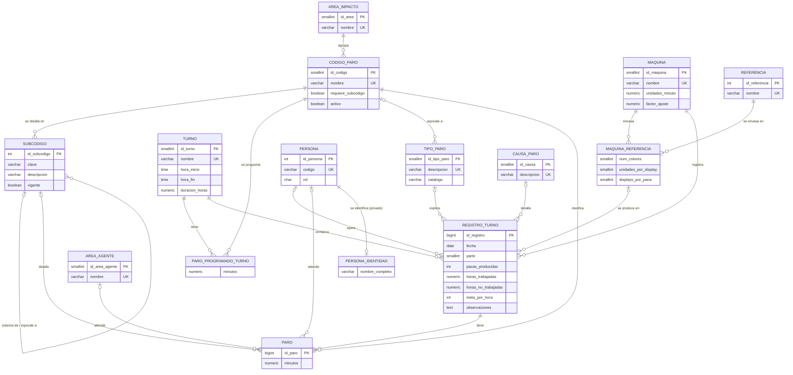

# 2. Modelo conceptual (MER)

Notación: pata de gallo. El diagrama está en Mermaid, así que GitHub lo dibuja directamente al abrir este archivo. Para el informe PDF se puede exportar con [mermaid.live](https://mermaid.live) o desde DBeaver (*ER Diagram* de la base `bd_paros`).

## 2.1 Entidades y atributos

| Entidad | Qué representa | Atributos principales | Identificador |
| --- | --- | --- | --- |
| ÁREA DE IMPACTO | Área responsable de un tipo de paro | nombre | id_area |
| CÓDIGO DE PARO | Código del P-MTO-22 (01 a 18) | nombre, requiere_subcodigo, activo | id_codigo (natural) |
| SUBCÓDIGO | Detalle de los códigos 01, 03 y 05 | clave, descripción, vigente | id_subcodigo |
| MÁQUINA | Línea de envasado | nombre, unidades_minuto, factor_ajuste | id_maquina |
| TURNO | Jornada de trabajo | nombre, hora_inicio, hora_fin, duración | id_turno |
| REFERENCIA | Producto envasado | nombre | id_referencia |
| PERSONA | Operaria o técnico, con seudónimo | código, rol, activo | id_persona |
| IDENTIDAD DE PERSONA | Nombre real (dato sensible) | nombre_completo | id_persona |
| ÁREA QUE ATIENDE | Quién resolvió un ajuste operativo | nombre | id_area_agente |
| TIPO DE PARO | Motivo de horas no trabajadas | descripción, catálogo | id_tipo_paro |
| CAUSA DE PARO | Causa detallada ("los porqué") | descripción | id_causa |
| REGISTRO DE TURNO | Lo que pasó en un turno de una máquina | fecha, pacas, horas trabajadas, horas no trabajadas, meta por hora, observaciones | id_registro |
| PARO | Cada interrupción dentro de un turno | minutos | id_paro |

Dos relaciones muchos a muchos tienen atributos propios y por eso aparecen como entidades asociativas:

- **MÁQUINA–REFERENCIA**: qué referencias puede envasar cada máquina, con número de colores, unidades por display y displays por paca.
- **PARO PROGRAMADO POR TURNO**: minutos estándar de los códigos 16 y 17 según el turno.

## 2.2 Relaciones, cardinalidad y participación

| Relación | Cardinalidad | Participación | Lectura |
| --- | --- | --- | --- |
| ÁREA DE IMPACTO agrupa CÓDIGO | 1 : N | Código total, área parcial | Todo código pertenece a un área; puede existir un área sin códigos. |
| CÓDIGO se detalla en SUBCÓDIGO | 1 : N | Subcódigo total, código parcial | Solo 01, 03 y 05 tienen subcódigos. |
| SUBCÓDIGO contiene SUBCÓDIGO (sistema → componente) | 1 : N recursiva | Parcial en ambos lados | 1.2 Sistema de dosificación contiene 1.2.A … 1.2.E. |
| SUBCÓDIGO equivale a SUBCÓDIGO | 1 : N recursiva | Parcial | El antiguo 4.4 equivale al vigente 5.5. |
| MÁQUINA envasa REFERENCIA | N : M | Parcial en ambos lados | Una referencia se envasa en varias máquinas. |
| TURNO tiene PARO PROGRAMADO de un CÓDIGO | N : M | Parcial | Solo los turnos con duración conocida y los códigos 16 y 17. |
| REGISTRO ocurre en MÁQUINA | N : 1 | Registro total | Todo registro es de una máquina. |
| REGISTRO ocurre en TURNO | N : 1 | Registro total | Si el Excel no lo traía, se usa el turno "No registrado". |
| REGISTRO es operado por PERSONA | N : 0..1 | Registro parcial | Un día sin producción no tiene operaria. |
| REGISTRO produce MÁQUINA–REFERENCIA | N : 0..1 | Registro parcial | La referencia debe estar habilitada para esa máquina. |
| REGISTRO se explica por TIPO y CAUSA | N : 0..1 | Registro parcial | Solo cuando hubo horas no trabajadas. |
| REGISTRO tiene PARO | 1 : N | **Paro total** (dependencia de existencia) | Un paro no existe sin su turno; si se borra el turno, se borran sus paros. |
| PARO se clasifica en CÓDIGO | N : 1 | Paro total | Todo paro tiene código. |
| PARO se detalla en SUBCÓDIGO | N : 0..1 | Paro parcial | Obligatorio para 01, 03 y 05 en capturas nuevas. |
| PARO es atendido por ÁREA y PERSONA | N : 0..1 | Paro parcial | Solo para el código 05. |
| PERSONA tiene IDENTIDAD | 1 : 0..1 | Identidad total | Se separa por seguridad; ver `07_privacidad.md`. |

## 2.3 Diagrama

## 2.4 Decisiones de modelado que conviene defender

- **El paro es una entidad, no una columna.** Es la decisión central: elimina los 18 pares de columnas y permite varios paros del mismo código en un turno, cada uno con su subcódigo.
- **El turno trabajado es el hecho principal**, no el día. El Excel registra por turno y el indicador se calcula por turno.
- **`parte` en el registro.** En 2022-2023 casi la mitad de las filas no tienen turno, así que la misma máquina, fecha y operaria aparece varias veces. `parte` numera esas filas y permite una clave natural única sin inventar turnos.
- **Tipo de paro separado de código de paro.** Se parecen, pero no son lo mismo: el tipo explica horas que no se programaron; el código explica un paro dentro de horas programadas. Además el tipo tiene un catálogo antiguo que hay que conservar.
- **La identidad de la persona es otra entidad** para poder darle permisos distintos.
